<p align="center">
  
</p>

<p align="center">
  
  
  
  
  
</p>

---

## What this is

**MAGITO** (*Modular Agent Governance & Task Orchestration*) is a personal,
version-controlled configuration layer for agentic command-line tools. One repo holds
your shared agent persona, skills, and subagents; an install script symlinks them into
the native config paths each tool expects. Edit once, `git pull` anywhere, and every
tool on every machine stays in sync.

<details>
<summary>Why "MAGITO"?</summary>

It is named after — and lightly modeled on — the **MAGI** supercomputer system from
*Neon Genesis Evangelion*: three semi-independent cores deliberating under one
governance layer. The MAGI decided the fate of humanity. This decides which markdown
file your CLI reads. The ambition here is deliberately *scoped*.

| MAGI core      | …governs       | Role here                                  |
|----------------|----------------|--------------------------------------------|
| **MELCHIOR**   | Claude Code    | Primary orchestrator — subagents and skills            |
| **BALTHASAR**  | Codex          | Shares the same persona via `AGENTS.md`    |
| **CASPER**     | Gemini CLI     | Shares the same persona via `GEMINI.md`    |
| —              | Antigravity    | Shares Gemini CLI's persona via the same `GEMINI.md` (enable only one) |
| —              | omp (Oh My Pi) | Shares the same persona via `AGENTS.md`    |

</details>

Every tool reads from a **single source of truth** (`shared/SYSTEM-INSTRUCTIONS.md`), so
your standards stay identical no matter which CLI you reach for.

The governance layer goes further than shared instructions. It keeps a session
journal — one file per session recording what happened and what is unfinished — so a
fresh session can pick up where the last one left off.

Learning to drive it? Read [Which skill when](#which-skill-when): the main path, one line for
every other skill, and the promises magito keeps.

## How it works

The model is dead simple: **files live in this repo; the tools read them via symlink.**
`install.py` (stdlib-only Python, 3.11+) reads your machine-local `install.toml` and
creates those symlinks for every tool you have enabled. Because they are symlinks:

- **Editing the content of an existing file is live instantly** — no reinstall. The tool
  reads through the link to the repo file.
- **Adding a *new* skill or agent requires a reinstall** — a new file needs a new link.

The script is idempotent (safe to re-run), and regenerates `skills/INDEX.md` from each
skill's frontmatter on every run. Exactly which repo path maps to which tool's native
config path is listed in [`CLAUDE.md`](CLAUDE.md).

## Quick start (first time on a machine)

```bash
git clone <repo-url> ~/code/magito
cd ~/code/magito

cp install.toml.example install.toml   # your local, gitignored config
$EDITOR install.toml                    # set enabled = true for tools you use

python install.py --dry-run            # preview every symlink it would create
python install.py                      # apply
```

That is it — your CLIs now read this repo.

## Cheat sheet

Short steps to remember. [Which skill when](#which-skill-when) explains each one.

### Set up a project (once per repo)

1. Open the repo in your agent and run **`/setup-magito`**. It checks what is already there, then asks only about what is missing. It is safe to re-run.
2. It asks one question first: **owner or guest?**
   - **Owner:** the repo is yours. magito's files are committed like any other file, and pull request titles follow Conventional Commits (`fix(scope): summary`).
   - **Guest:** the repo belongs to a team. magito never edits a file the team tracks. Everything it creates is listed in `.git/info/exclude`, so none of it shows up in `git status` or a commit. Pull requests follow the repo's own template (`.github/pull_request_template.md`) and its title style.
3. Your answer and the other settings land in `.magito/config.toml`. Change a choice by editing that file or re-running `/setup-magito`.

### The daily loop

You run the loop in a planner session. Each ticket then builds in its own worker session.

```
/catch-up              start: what happened last time, and what is next
/intent                describe the change; answer one question at a time; say "accept"
to-issues              runs after "accept": publishes tickets, offers one session
                       card per ticket that is ready to start
/implement <n>         each card starts a worker session that runs this
read the diff          the worker stops at "ready to read"; you read its diff
open the pull request  you tell the worker to open it (a Low-risk ticket's opens before your read)
merge the pull request on GitHub
/handoff               end: one short journal entry
```

- **Already know exactly what to build?** Skip `/intent`. Run `/to-issues` with your plan, which asks you to approve the breakdown. Or run `/implement 42` on one clear issue. It shows its plan and goes on. It waits for your approval only when you ask to see the plan first. When the branch has a commit ahead of its base, it reviews the change and stops at "ready to read". A Low-risk ticket's pull request opens then. A Normal or High ticket's pull request opens when you say so. When the branch has no commit, it posts its findings on the ticket and opens nothing.
- **A quick fix?** Ask the agent directly and call no skill. You decide yourself whether to review it.
- **Several unrelated issues at once?** Run each in its own worker session, one per ticket. Run one session at a time by default. Run two at once only when the planner says the tickets are independent. Or give one worker a batch such as `/implement 14 15 16`, which builds each ticket in turn. For a Normal or High ticket, it stops at "ready to read". For a Low ticket, it opens the pull request and the batch moves on. Each ticket gets its own pull request.
- **Interrupted?** Start a new session and run the same `/implement <tickets>` again. It carries on.

### What stops for you

Only these:

1. **A refusal at the start of an `implement` run.** The ticket has an open blocker, or the tracker adapter file that was passed does not exist.
2. **Accepting an intent.** You say "accept" to `/intent`.
3. **Approving the `to-issues` breakdown**, only when its input is a plan rather than an accepted intent.
4. **A failed `to-issues` spec review.** A defect is still open after three rounds, or the reply is malformed.
5. **The plan**, only when you ask to see it first.
6. **"Ready to read".** You read the diff. A Low-risk ticket opens its pull request first.
7. **An escalation.** `implement` stops and asks for one of four named reasons:
   1. the ticket is ambiguous in a way it does not settle;
   2. passing needs a locked test changed, or work outside the ticket;
   3. the red check passes before any change;
   4. no check command exists.
8. **Three `/code-review` rounds that end with findings.** `implement` lists what remains and names the next tries.
9. **The merge.** You own every merge.

The agent quotes the evidence each time. Everything else it decides alone and lists in the pull request body for you to overrule at the merge.

### Settings that change behavior

| Setting | Where | Effect |
|---|---|---|
| `mode` | `.magito/config.toml` | `owner` or `guest`, as above |
| `check` | `.magito/config.toml` | the one command that must pass after every build step |
| `Tracker:` in an intent's header | the intent doc | use `local` or `other` instead of the repo's default tracker for that intent |
| `magito.prTitlePattern` | `git config` | the pull request title rule; `off` for a guest repo with its own style |
| `magito.baseBranch` | `git config` | merge into a branch other than the default, such as `develop` |

### Where things live

| Path | What |
|---|---|
| `.magito/config.toml` | this repo's magito settings (never committed) |
| `.magito/journal/` | one file per session, read by `/catch-up` |
| `docs/intent/` | intent docs (in a guest repo, hidden from git) |
| `~/.magito/bench.toml` | this machine's `/magi` seats |
| `install.toml` | which tools this machine installs into (gitignored) |

## Which skill when

Skills are the source of truth. If this section disagrees with a skill, the skill is right and
this section needs a fix.

### The main path

Most work follows one path. You act at three points: accepting the intent, reading each
diff, and the merge.

1. **`/catch-up`** starts a session. It reads the journal, the tracker, and git, then names the next move.
2. **`/intent`** interviews you one question at a time and produces an intent doc. You act here: you accept the doc.
3. **`to-issues`** runs on its own after you accept. It turns the intent into reviewed tickets, publishes them, and offers one session card per ticket that is ready to start.
4. **`implement`** runs in a worker session that each card starts. It shows its plan and goes on, builds the ticket, and reviews the change with `/code-review`. It stops at "ready to read". You act here: you read the diff. A Low-risk ticket opens its pull request at this point. For a Normal or High ticket, you tell the worker to open it.
5. **The pull request** is the result. You act here: you decide the merge. The planner session runs the merge only when you say so for that pull request. In a repo with no remote, the agent stops and asks instead, and merges only after you approve.
6. **`/handoff`** ends the session with one entry in `.magito/journal/`.

Work with no accepted intent can still enter at `/to-issues` (a plan) or `/implement` (one clear
issue). `/to-issues` asks you to approve its breakdown. `/implement` runs the same steps for
that ticket as for any other. It shows its plan and goes on, and waits for your approval only
when you ask to see the plan first. A branch with no commit ahead of its base holds no
change, so it gets no review and no pull request, and the run posts its findings on the ticket.

### Every other skill

- **`/magi`**: a three-seat tribunal for a question no test can settle. Poll is cheap; `deliberate` asks for cost consent first.
- **`/decruft`**: a harsh structural review for the cruft that agents leave behind. It proposes cuts; you approve them.
- **`/challenging-assumptions`**: an adversarial pre-mortem of a plan before you commit, ending in a verdict.
- **`/research`**: an evidence-backed report on an open question, with options and a recommendation.
- **`/reviewing-changes`**: the two-axis review (Standards and Spec) of work done outside `implement`.
- **`/speaking-plainly`**: reset your writing voice, or rewrite dense text plainly.
- **`/teach`**: learn a concept over several sessions, using the current directory as the workspace.
- **`/to-questionnaire`**: turn a decision you cannot make alone into a questionnaire for one person.
- **`/wait-what`**: re-pitch the last message when it did not land.
- **`/domain-modeling`**: sharpen the project vocabulary and record decisions in the glossary and ADRs.
- **`/verifying`**: the testing discipline for Python work: real seams, red-green, and data checks.
- **`/writing-for-agents`**: write skills, `AGENTS.md`, `CLAUDE.md`, issues, and prompts that agents read well.
- **`/setup-magito`**: audit and repair one repo's magito configuration. Run it once per new project; it is safe to re-run.

### What magito promises

1. **You own every merge.** Agents branch, commit, and open pull requests. You decide every merge, and the planner session runs the merge only when you say so for that pull request. In a repo with no remote, an agent merges only after your explicit approval.
2. **You read every diff before its pull request opens.** The one exception is a Low-risk ticket, whose pull request opens right after the "ready to read" message. A branch with no commit ahead of its base holds no change, so it gets no pull request. Work you ask an agent for directly, outside `implement`, gets a review only when you decide it does.
3. **Machine-local files are yours.** `~/.magito/` is bootstrapped once with your consent and never overwritten on an agent's own initiative. `bin/` is the exception: `install.py` owns it.
4. **Staging is always explicit.** The shared instructions tell every agent never to bulk-stage files.
5. **Costs are stated before they are incurred.** Magi deliberate mode asks before it convenes.

You stay in the loop at these moments only: a refusal at the start of an `implement` run (an
open blocker, or a tracker adapter file that does not exist), accepting an intent, approving
the breakdown for a plan with no accepted intent, a `to-issues` spec review that still has a
defect after three rounds, the plan when you ask to see it first, reading each diff at
"ready to read", an escalation, three review rounds that end with findings, magi deliberate
cost consent, and every merge. The build runs on its own between those moments, in a session
you can watch.

---

## User guide

### 🔄 Syncing a change to another machine

This is the one you will reach for most. You changed something on machine A; pull it down
on machine B:

```bash
cd ~/code/magito
git pull
python install.py        # only strictly needed if NEW skills/agents/tools/bin files were added
```

**Rule of thumb for whether you need `install.py` after a pull:**

| What changed in the pull                                  | Reinstall needed? |
|-----------------------------------------------------------|-------------------|
| Edited `SYSTEM-INSTRUCTIONS.md` or an existing `SKILL.md`  | **No** — symlink already points there, change is live |
| Added a brand-new skill, agent, tool stanza, or `bin/` file (e.g. `journal`) | **Yes** — needs a new symlink |
| Not sure                                                  | Just run it — it is idempotent and harmless |

When in doubt, run `python install.py`. It never does damage on a re-run.

<details>
<summary>➕ Adding a new skill, subagent, or tool</summary>

Full steps for each — which directory a skill goes in, subagent frontmatter fields,
wiring up a new tool stanza — live in [`CLAUDE.md`](CLAUDE.md) under
"Adding a New Skill / Agent / Tool". That is the file the agents themselves read
before extending this repo, so it stays the one source of truth for these steps.

Short version, every case: create the file with the right frontmatter, then run
`python install.py` to symlink it and regenerate `skills/INDEX.md`.

</details>

<details>
<summary>🩺 Troubleshooting</summary>

```bash
python install.py --dry-run     # show what WOULD happen, change nothing
python install.py --force       # replace symlinks that currently point elsewhere
ls -la ~/.claude/CLAUDE.md       # confirm a link resolves back into this repo
```

- **A tool isn't picking up changes?** Check the symlink actually points here:
  `ls -la <native-path>`. If it points somewhere stale, re-run with `--force`.
- **`install.py` gotcha (for hacking on the script):** never call `.resolve()` on a
  *destination* path before linking — it follows existing symlinks back to the source
  and breaks idempotency.

</details>

---

Full repo layout and the per-tool path table live in [`CLAUDE.md`](CLAUDE.md), kept in
one place so they do not drift out of sync with what the agents actually see.

---

<p align="center"><sub>
  MELCHIOR · BALTHASAR · CASPER — deliberation complete. <b>STATUS: READY.</b>
</sub></p>
